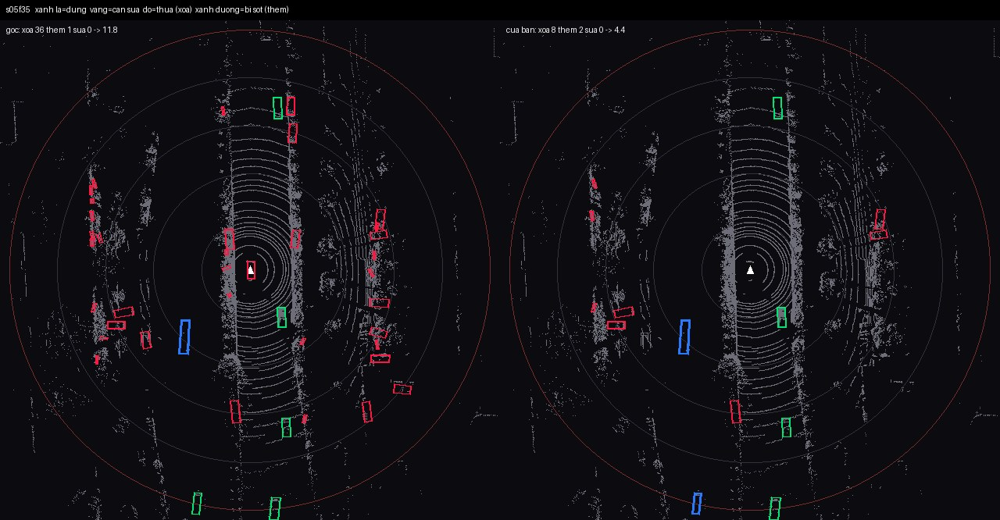

# Báo cáo Day 14 — Vũ Văn Đăng — 2A202603046

- Mã học viên dùng với `--student`: `2A202603046`
- `seed_tag` trong `frames_A.txt`: `393590736f`
- Tập A: `s01f20`, `s04f41`, `s05f35`.
- Phiên bản báo cáo: hoàn thiện sau sweep, so sánh tập A và xuất nhãn tập B.
- Dự đoán ban đầu được lưu tại commit `6947d29b64b504f02fc0fc8d3b476513c3ed71ad`; mục 1 được giữ nguyên.

## 1. Dự đoán trước sweep (bước 5b)

Phần này ghi giả thuyết để commit và push **trước** khi chạy `scripts/pp_sweep.py`. Giữ nguyên nội dung mục 1 sau sweep và đối chiếu kết quả tại mục 3.

- **Tham số tôi dự đoán giảm công sửa nhiều nhất:** `score_thr`. Tôi dự đoán tăng ngưỡng từ cấu hình gốc `0.1` lên khoảng `0.3` sẽ loại bớt box có độ tin cậy thấp và giảm số box phải xóa. Đây là giả thuyết, chưa phải cấu hình tối ưu đã được kiểm chứng.
- **Cơ sở quan sát:** trên ảnh BEV kết hợp các góc camera trong `d14_2A202603046/png_A/`, dấu hiệu box thừa nổi bật ở hai frame `s01f20` và `s05f35`. Nhiều box Car, Cyclist hoặc Pedestrian nằm dọc vùng cây, bụi cây và dải phân cách, trong khi ảnh camera không cho thấy rõ vật thể tương ứng. Ở `s04f41`, một số box Car gần xe thật tương đối hợp lý, nhưng vẫn có box đáng nghi dọc hàng rào và khu vực ven đường. Vì vậy, tôi ưu tiên thử lọc các dự đoán độ tin cậy thấp để giảm công xóa; nhận xét này không có nghĩa mọi box ven đường đều sai.
- **Tham số thử kết hợp:** tăng `min_points` từ `0` lên `5` để loại box có quá ít điểm LiDAR hỗ trợ. Tôi dự đoán tác dụng của tham số này có thể hạn chế vì cây và hàng rào cũng có nhiều điểm, nên box sai ở các vùng đó chưa chắc bị loại.
- **Đánh đổi cần kiểm chứng:** tăng ngưỡng quá cao có thể làm mất box đúng của vật thể ở xa, bị che khuất hoặc ít điểm, đặc biệt là Pedestrian/Cyclist. Theo công thức `0.3 × xóa + 1.0 × thêm + 0.5 × sửa`, bỏ sót một vật thể có chi phí thêm lớn hơn chi phí xóa một box thừa. Do đó, tôi dự đoán mức ngưỡng vừa phải sẽ phù hợp hơn việc tăng ngay lên `0.5`; cần đối chiếu cả số box xóa, thêm và sửa sau sweep.
- **Cách kiểm chứng dự kiến:** sweep `score_thr=0.1,0.2,0.3,0.4,0.5` và `min_points=0,5,10` trên tập A với `ref_A.json`, rồi xem chi phí tổng và kết quả leave-one-out. Chưa kết luận mức giảm công sửa hay khả năng áp dụng sang tập B ở bước này.

## 2. Tập A: sửa tay và tune

Nhãn tham chiếu `ref_A.json` có đủ 3 frame, tổng cộng 34 cuboid; 29 cuboid nằm trong phạm vi chấm 50 m. Bản nhãn này khớp với dữ liệu đã lưu của task CVAT `D14-2A202603046-A` (ID 30).

| Cấu hình | Xóa | Thêm | Sửa | Chi phí |
|---|---:|---:|---:|---:|
| Gốc (`score_thr=0.1`, `min_points=0`) | 68 | 4 | 0 | 24.4 |
| `best_config.json` (`score_thr=0.5`, `min_points=0`) | 12 | 7 | 0 | 10.6 |

Đã thử 15 tổ hợp: `score_thr=0.1,0.2,0.3,0.4,0.5` và `min_points=0,5,10`. Tham số duy nhất thay đổi so với cấu hình gốc là **`score_thr: 0.1 → 0.5`**. Tại ngưỡng `0.5`, ba giá trị `min_points` đều cho chi phí `10.6`; cấu hình được script chọn giữ `min_points=0`. Vì vậy, chưa có bằng chứng việc tăng `min_points` giúp thêm ở ngưỡng này.

Kết quả leave-one-out từ lần chạy kiểm chứng `scripts/pp_sweep.py` (kết quả CSV và cấu hình trùng với các file sweep đã có):

```text
Leave-one-out (chọn trên các frame còn lại, chấm trên frame bỏ ra):
  s01f20: cấu hình chọn {'score_thr': '0.5', 'min_points': '0'} → 4.9 (tốt nhất có thể 4.5)
  s04f41: cấu hình chọn {'score_thr': '0.5', 'min_points': '0'} → 1.3 (tốt nhất có thể 1.3)
  s05f35: cấu hình chọn {'score_thr': '0.4', 'min_points': '0'} → 5.9 (tốt nhất có thể 4.4)
```

Lựa chọn chưa hoàn toàn ổn định: khi bỏ `s05f35`, hai frame còn lại chọn ngưỡng `0.4`, khiến chi phí trên frame bị bỏ ra là `5.9`, cao hơn mức tốt nhất `4.4`. Với `s01f20`, cấu hình chọn cũng cao hơn mức tốt nhất riêng của frame `0.4` điểm. Tôi vẫn dùng ngưỡng `0.5` cho tập B vì nó có tổng chi phí thấp nhất trên toàn bộ tập A và giảm chi phí trên cả ba frame so với cấu hình gốc; kết quả này không bảo đảm tối ưu trên dữ liệu khác.

| Frame A | Chi phí gốc | Chi phí cấu hình chọn |
|---|---:|---:|
| `s01f20` | 9.2 | 4.9 |
| `s04f41` | 3.4 | 1.3 |
| `s05f35` | 11.8 | 4.4 |
| **Tổng** | **24.4** | **10.6** |

Số “sửa = 0” là kết quả theo ngưỡng ghép và sai lệch của script, không có nghĩa toàn bộ cuboid hoàn hảo hoặc không cần kiểm tra bằng mắt. Log kiểm chứng: [sweep.txt](../../d14_2A202603046/evidence/sweep.txt).

## 3. Trước/sau (bước 8)



Ảnh bên trái là cấu hình gốc, bên phải là cấu hình đã chọn. Xanh lá: giữ; vàng: cần sửa; đỏ: cần xóa; xanh dương: vật thể bị sót cần thêm theo nhãn tham chiếu.

`scripts/pp_compare.py` báo giảm **57%** công sửa trên tập A (làm tròn). Tính từ tổng chi phí: `(24.4 - 10.6) / 24.4 × 100 = 56.56%`.

Dự đoán ở mục 1 **đúng về hướng tăng `score_thr` nhưng chưa đúng về mức ngưỡng phù hợp nhất**. Ngưỡng `0.3` cho chi phí `17.3` nếu giữ `min_points=0`, hoặc `17.0` với `min_points=5/10`; ngưỡng `0.5` cho chi phí thấp hơn, `10.6`. So với cấu hình gốc, số box phải xóa giảm từ 68 xuống 12, nhưng số box cần thêm tăng từ 4 lên 7; số sửa vẫn bằng 0. Lợi ích do giảm 56 thao tác xóa là `56 × 0.3 = 16.8` điểm, lớn hơn 3 điểm tăng do thêm box bị sót, nên chi phí giảm ròng `13.8` điểm.

Riêng `s05f35`, số xóa giảm từ 36 xuống 8, số thêm tăng từ 1 lên 2 và số sửa vẫn bằng 0; chi phí giảm từ `11.8` xuống `4.4`. Ảnh minh họa cho thấy nhiều box đỏ đã được lọc, nhưng vẫn còn box thừa và vật thể cần thêm. Giả thuyết tăng `min_points` chưa đem lại lợi ích ở cấu hình cuối cùng.

Log so sánh: [compare.txt](../../d14_2A202603046/evidence/compare.txt). Mức giảm trên chỉ áp dụng cho tập A và nhãn tham chiếu hiện tại, không phải số đo thời gian thao tác.

## 4. Tập B

Đã hoàn tất kiểm tra/gán nhãn 12 frame trên CVAT và bấm Save. Nhãn được xuất từ dữ liệu đã lưu của task `D14-2A202603046-B` (ID 31) vào `ref_B.json`; task không có Track. Bản xuất dùng hàm chuyển đổi `cuboid_from_cvat(..., scale_order="lwh")` của repo, cùng cách chuyển tọa độ và làm tròn như lệnh `vf_cvat.py reference`.

`ref_B.json` chứa đủ 12 frame và **147 cuboid**. Có **145 cuboid trong phạm vi 50 m** được dùng để chấm; hai cuboid ngoài phạm vi vẫn được giữ trong file xuất. Cả 12 frame có thay đổi so với `pred_B.json` khi đối chiếu lớp, vị trí, kích thước và yaw. Cấu hình trong `pred_B.json` khớp `best_config.json`.

Số đo được kiểm chứng bằng lệnh:

```powershell
python scripts/pp_prelabel.py --data Data-VF --frames d14_2A202603046/frames_B.txt --config d14_2A202603046/best_config.json --gt d14_2A202603046/ref_B.json
```

| Xóa | Thêm | Sửa | Chi phí |
|---:|---:|---:|---:|
| 44 | 34 | 2 | 48.2 |

Trong phạm vi chấm: 155 box dự đoán, 145 box tham chiếu và 111 cặp ghép. Chi phí là `0.3 × 44 + 1.0 × 34 + 0.5 × 2 = 48.2`.

| Frame B | Xóa | Thêm | Sửa | Chi phí |
|---|---:|---:|---:|---:|
| `s01f02` | 2 | 13 | 1 | 14.1 |
| `s01f33` | 2 | 1 | 0 | 1.6 |
| `s01f59` | 4 | 3 | 0 | 4.2 |
| `s02f01` | 3 | 1 | 1 | 2.4 |
| `s02f28` | 4 | 2 | 0 | 3.2 |
| `s02f55` | 4 | 1 | 0 | 2.2 |
| `s03f08` | 8 | 4 | 0 | 6.4 |
| `s03f32` | 3 | 2 | 0 | 2.9 |
| `s03f51` | 8 | 2 | 0 | 4.4 |
| `s04f08` | 4 | 2 | 0 | 3.2 |
| `s04f28` | 1 | 2 | 0 | 2.3 |
| `s04f53` | 1 | 1 | 0 | 1.3 |
| **Tổng** | **44** | **34** | **2** | **48.2** |

Phần tốn công nhất theo công thức là **thêm vật thể bị sót**, đóng góp 34 điểm trên tổng 48.2 điểm. Trong 34 box cần thêm, Pedestrian nhiều nhất (12), tiếp theo Cyclist (8), Bus (6), Car (5) và Truck (3). Điều này phù hợp với hạn chế của mô hình KITTI và tác động của ngưỡng lọc cao, nhưng chưa đủ để xác định riêng mức đóng góp của từng nguyên nhân. Hai box được tính cần sửa thuộc lớp tham chiếu Cyclist và Truck; các box cần xóa gồm 28 Car, 15 Cyclist và 1 Pedestrian.

Frame `s01f02` có chi phí cao nhất (`14.1`), chủ yếu vì phải thêm 13 box. Các số trên được đối chiếu giữa pre-label và nhãn cuối cùng, không phải log đếm từng thao tác người dùng trong CVAT.

Bằng chứng: [metrics_B.txt](../../d14_2A202603046/evidence/metrics_B.txt) và [metrics_summary.json](../../d14_2A202603046/metrics_summary.json).

## 5. Giới hạn

- Tập A chỉ có 3 frame, nên cấu hình có chi phí thấp nhất trên tập A có thể không phù hợp với 12 frame tập B. Cần xem leave-one-out trước khi đánh giá tính ổn định.
- Model được huấn luyện trên KITTI, khác dữ liệu VF về cảm biến và bối cảnh. KITTI không có lớp Truck/Bus trong mô hình này; việc đổi lớp dựa trên kích thước có thể sai và vẫn cần người kiểm tra.
- Chi phí `0.3 × xóa + 1.0 × thêm + 0.5 × sửa` là chỉ số quy ước, không phải thời gian thao tác thực tế. Chưa thể quy đổi mức giảm chi phí thành số phút hoặc giờ tiết kiệm.
- Nhận xét từ ảnh chiếu và BEV chỉ hỗ trợ hình thành giả thuyết. Vật thể bị che khuất hoặc ở xa cần được kiểm tra thêm trên point cloud và các góc camera trước khi quyết định xóa hay thêm nhãn.
